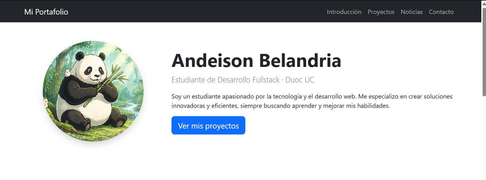
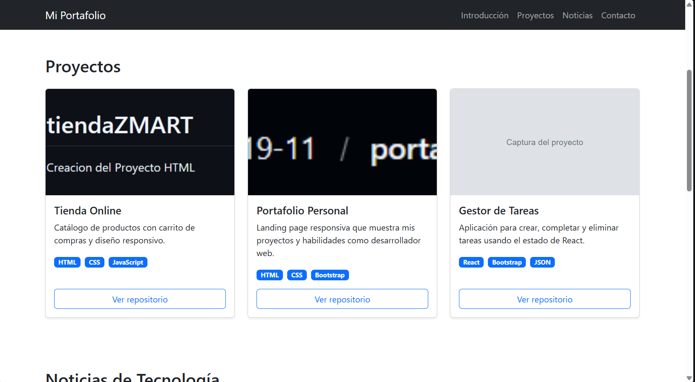
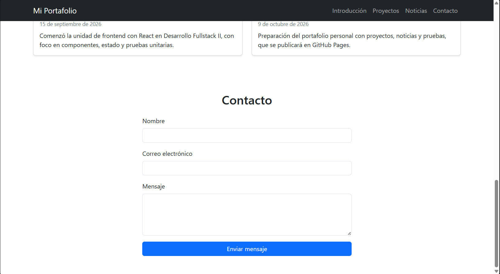

# Portafolio Personal – Andeison Belandria

Portafolio web desarrollado con **React** y **Bootstrap** para la asignatura **DSY1104 – Desarrollo Fullstack II** (Duoc UC), Evaluación Formativa N° 2. Incluye pruebas unitarias con **Jasmine y Karma** e informe de cobertura.

🔗 **Sitio publicado:** [pendiente: agregar el enlace de GitHub Pages]

## Capturas de pantalla

| Escritorio | Móvil |
|---|---|
|  |  |

| Proyectos | Formulario de contacto |
|---|---|
|  |  |

## Características

- **Introducción:** nombre, foto y biografía recibidos por *props*.
- **Proyectos:** Cards de Bootstrap con imagen, título, descripción, tecnologías y enlace, cargadas desde `public/data/projects.json`.
- **Noticias:** dos secciones (Tecnología y Académico) cargadas desde `public/data/news.json` y filtradas por categoría con un mismo componente reutilizable.
- **Contacto:** formulario de Bootstrap con estado controlado y validación.
- **Diseño responsivo** con el sistema de grillas de Bootstrap y menú hamburguesa.
- **Accesibilidad:** textos alternativos en imágenes, etiquetas asociadas a los campos y navegación por teclado.

## Tecnologías

- React 19 (state, props y hooks)
- Vite
- Bootstrap 5
- Jasmine + Karma (pruebas unitarias)
- karma-coverage (informe de cobertura)

## Requisitos previos

- [Node.js](https://nodejs.org/) (versión LTS)
- [Git](https://git-scm.com/)
- Google Chrome (lo usa Karma para ejecutar las pruebas)

## Instalación

```bash
git clone https://github.com/Kratos19-11/portafolio-dsy1104.git
cd portafolio-dsy1104
npm install
```

## Ejecución

```bash
npm run dev
```

Abre <http://localhost:5173/> en el navegador.

Para generar la versión de producción:

```bash
npm run build
```

## Pruebas unitarias

```bash
npm test
```

Ejecuta todas las pruebas una vez con Karma y Jasmine en Chrome Headless y genera el informe de cobertura.

```bash
npm run test:watch
```

Modo observador: vuelve a ejecutar las pruebas al guardar cambios.

### Cobertura de código

Al ejecutar `npm test` se genera el informe en `coverage/index.html` (ábrelo con el navegador).

| Métrica | Resultado |
|---|---|
| Sentencias | 100% |
| Ramas | 92.64% |
| Funciones | 100% |
| Líneas | 100% |

**52 pruebas** en total. El detalle de los casos y resultados esperados está en el [plan de pruebas](docs/plan-de-pruebas.md).

## Estructura del proyecto

```
portafolio-dsy1104/
├── docs/                    # Plan de pruebas y capturas
├── public/
│   ├── data/                # projects.json y news.json
│   └── images/              # Foto de perfil e imágenes de proyectos
├── src/
│   ├── components/
│   │   ├── contact/         # ContactForm
│   │   ├── introduction/    # Introduction
│   │   ├── layout/          # NavBar
│   │   ├── news/            # NewsSection, NewsItem
│   │   └── projects/        # ProjectsSection, ProjectCard
│   ├── hooks/               # useFetchJson
│   ├── services/            # dataService (lectura de JSON)
│   ├── styles/              # Estilos personalizados
│   └── tests/               # Configuración de pruebas
└── karma.conf.cjs           # Configuración de Karma
```

Cada componente tiene su archivo de pruebas (`*.spec.jsx`) en la misma carpeta.

## Ejemplos de uso

**Agregar un proyecto:** añade un objeto a `public/data/projects.json`. Aparece automáticamente en la sección Proyectos, sin tocar el código.

```json
{
  "id": 4,
  "title": "Mi nuevo proyecto",
  "description": "Descripción breve.",
  "image": "images/projects/mi-proyecto.png",
  "imageAlt": "Captura de mi nuevo proyecto",
  "technologies": ["React", "Bootstrap"],
  "url": "https://github.com/usuario/mi-proyecto",
  "linkLabel": "Ver repositorio"
}
```

**Agregar una noticia:** añade un objeto a `public/data/news.json` con `"category": "Tecnología"` o `"category": "Académico"` para que aparezca en la sección correspondiente.

**Reutilizar un componente:** `NewsSection` recibe sus datos por props.

```jsx
<NewsSection sectionId="noticias" title="Noticias de Tecnología" category="Tecnología" />
```

## Autor

**Andeison Belandria** – Estudiante de Ingenieria en Informatica, Duoc UC
GitHub: [@Kratos19-11](https://github.com/Kratos19-11)